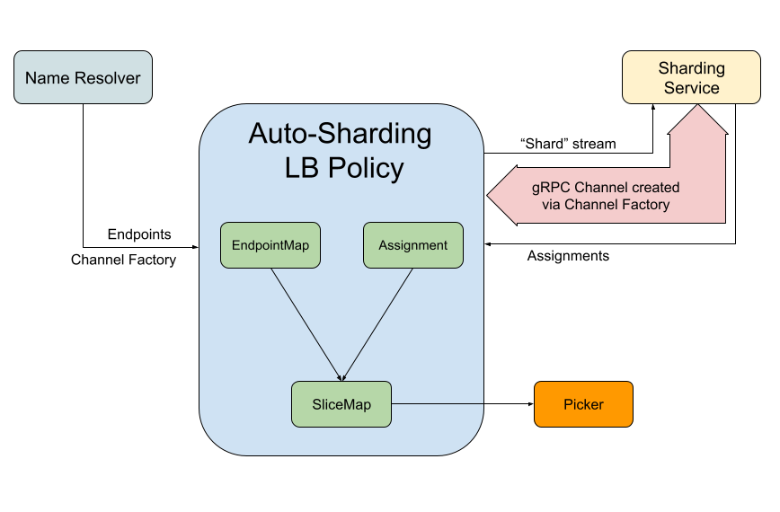
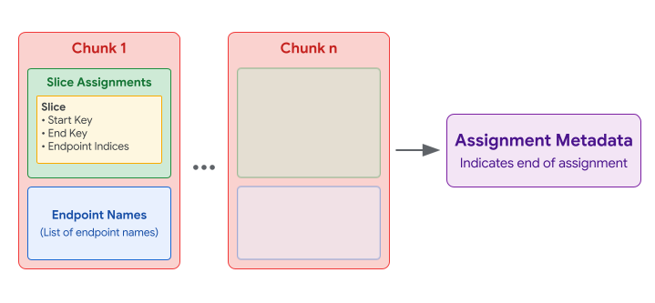

A119: Auto-Sharding LB Policy
----
* Author: easwars
* Approver: markdroth
* Implemented in: Go
* Last updated: 2026-11-13
* Discussion at: <https://groups.google.com/g/grpc-io/c/BXcwH6ytqRs>

## Abstract

Add support for an auto-sharding load balancing policy, that communicates with
an external sharding service to receive resource assignments. This policy should
be supported in both xDS and non-xDS based deployments.

## Background

An auto-sharding service enables client-side load balancing through the
following process:

* Dividing the keyspace into distinct, non-overlapping ranges (or slices)
* Assigning specific resources to these key ranges
* Adjusting these mappings in real-time to account for resource availability and
  fluctuating load
* Gathering load metrics for keys within an application-defined keyspace

Within this framework, application-defined keys generally consist of arbitrary
byte sequences, such as:

* Individual User IDs or Project IDs
* Tenant identifiers for multi-tenant architectures
* Identifiers created via hashing

The targets for traffic distribution, or resources, frequently include:

* Application servers
* Kubernetes pods within a cluster

Implementing a load balancing policy in gRPC that uses an auto-sharding service
has applications in various scenarios, such as:

* Enhancing request affinity in stateful environments
* Improving isolation and system resilience for multi-tenant services
* Providing the scalability required for rapid growth in AI-driven applications

### Related Proposals

* [A42: xDS Ring Hash LB Policy][A42]
* [A52: gRPC xDS Custom Load Balancer Configuration][A52]
* [A56: Priority LB Policy][A56]
* [A62: Pick First][A62]
* [A74: xDS Config Tears][A74]
* [A75: xDS Aggregate Cluster Behavior Fixes][A75]
* [A78: gRPC OTel Metrics for WRR, Pick First, and XdsClient][A78]
* [A81: xDS Authority Rewriting][A81]
* [A102: xDS GrpcService Support][A102]
* [A117: Ring Hash Exit Idle Behavior Changes][A117]
* [A121: RPC Delay Observability][A121]

## Proposal

Add the `autosharding_experimental` LB policy in gRPC that contains the
following functionality:

* Utilizing the [OSS Autosharding gRPC protocol][Autosharding] for communicating
  with a sharding service and processing assignments from that service.
  * These assignments will partition an application-defined keyspace into
    distinct, non-overlapping key-ranges or slices, each associated with a set
    of server endpoints.
* Mapping client application requests to a specific key within the
  application-defined keyspace.
* Identifying the matching key-range and choosing a server endpoint assigned to
  it.
* Providing a fallback mechanism to route client traffic when assignments from
  the sharding service are unusable.

Crucially, the LB policy receives its configuration and endpoint data from the
Name Resolver and not from the sharding service.

### Supported modes of operation

The LB policy must support two primary modes of operation:

* An LB policy that performs both locality and endpoint picking:
  * In xDS use-cases, such an LB policy receives endpoints across all
    localities and shards requests accordingly. This is similar to how the
    `ring_hash` LB policy, specified in [gRFC A42][A42], works.
  * In non-xDS use-cases, such an LB policy will be configured as the top-level
    LB policy, sharding requests across a flat list of endpoints provided by the
    Name Resolver.
* An LB policy that only performs endpoint picking:
  * In xDS use-cases, such an LB policy will be configured under a policy like
    `weighted_target_experimental` that handles locality picking, while each
    `autosharding_experimental` child policy instance only handles endpoint
    picking within its specific locality.

The LB policy must maintain consistent behavior across both modes and must not
require explicit knowledge of its operational context. Notably, we do not
support using this LB policy solely for locality picking with delegation to a
separate endpoint-picking policy. This configuration lacks identified use cases
and introduces significant implementation complexity.

### LB Policy Architecture



The LB policy receives the following information from the Name Resolver apart
from its configuration:

* A set of endpoints where each endpoint may include an optional hostname
  attribute. If this attribute is missing, the first address associated with the
  endpoint shall serve as the hostname. The endpoint hostname attribute
  described in [gRFC A81][A81] will be used here.
* A "Channel Factory" that returns a fully functional gRPC Channel to the
  sharding service, given an opaque string specified in the configuration.

#### EndpointMap

The endpoints are stored in a map where the key is the hostname of the endpoint,
and the value is the state associated with the endpoint. This state includes a
child `pick_first` LB policy that is created lazily, and the most recent
connectivity state and picker returned by that policy. We'll call this map the
`EndpointMap` going forward. This could look something like this:

```python
# Endpoint state used in the LB policy.
#
# The same EndpointState object is retained (and updated in place) across Name
# Resolver updates for as long as the endpoint is present. This guarantees that
# references to it held by the child policy (for delivering state updates) and
# by previously created pickers (for requesting connections) remain valid.
class EndpointState:
  index:    int                # Index of the endpoint within the NR update
  endpoint: Endpoint           # The actual endpoint returned by the NR
  child_lb: Balancer           # Child balancer managing the endpoint
  state:    ConnectivityState  # Most recent connectivity state of the endpoint
  picker:   Picker             # Most recent picker returned by the child balancer
  removed:  bool               # Set when the endpoint is removed by the NR

  # Called to request a connection.
  # Lazily creates the LB policy as needed.
  def request_connection(self):
    if self.removed:
      return
    if self.child_lb is None:
      # ...create child policy...
    self.child_lb.exit_idle()

  # Called when a Name Resolver update retains this endpoint.
  def update(self, index: int, endpoint: Endpoint):
    self.index = index
    self.endpoint = endpoint
    if self.child_lb is not None:
      self.child_lb.update(endpoint.addresses)

  # Called when a Name Resolver update removes this endpoint.
  def shutdown(self):
    self.removed = True
    if self.child_lb is not None:
      self.child_lb.close()
      self.child_lb = None

# Map from endpoint hostname to endpoint state
class EndpointMap:
  m: dict[str, EndpointState]
```

The LB policy must create or update its `EndpointMap` whenever it receives
endpoints from the Name Resolver. If multiple endpoints share the same hostname,
implementations may arbitrarily pick one and drop the others.

```python
# Builds an EndpointMap with the new set of resolver endpoints.
def update_endpoint_map(self, resolved_endpoints: list[Endpoint]):
  old_map = self.endpoint_map.m if self.endpoint_map is not None else {}
  new_map = EndpointMap(m={})

  for endpoint in resolved_endpoints:
    # De-duplicate endpoints sharing the same hostname within this update.
    if endpoint.hostname in new_map.m:
      continue

    # Retain the existing EndpointState object (not a copy) for endpoints
    # still present, so that references to it remain valid.
    es = old_map.pop(endpoint.hostname, None)
    if es is None:
      es = EndpointState()
    es.update(index=len(new_map.m), endpoint=endpoint)
    new_map.m[endpoint.hostname] = es

  # Anything left in old_map was removed in this update.
  for es in old_map.values():
    es.shutdown()

  self.endpoint_map = new_map
```

The pseudo-code above retains the `EndpointState` (and its child policy) by
hostname and pushes updated addresses to the child policy. Implementations may
use a different notion of identity for retaining an `EndpointState` and its child
policy across updates, as long as the `EndpointState` and the child policy are
always retained or replaced together. For example, in Go, child policies are
managed by the `endpointsharding` LB policy, which identifies its children by the
set of addresses in the endpoint. So the Go implementation retains `EndpointState`
objects keyed by that set of addresses. When a hostname moves to a different set
of addresses, a new `EndpointState` and child policy are created for it.

The LB policy must update the existing `EndpointMap` when it receives an
update from the child policy. This means that the `EndpointMap` cannot be shared
with the picker without synchronizing access to it. Instead, we propose creating
a new data structure that contains only the fields from `EndpointState` that the
`Picker` needs access to.

```python
# Endpoint state used in the picker.
class PickerEndpoint:
  state:    ConnectivityState
  picker:   Picker

  # The purpose of this field is to allow the Picker to trigger a connection
  # attempt on the child policy. If the child LB policy instance does not yet
  # exist, the implementation MUST lazily create it before triggering the
  # connection attempt. Implementations are free to use a type that is
  # most appropriate for them.
  #
  # A name resolver update that removes an endpoint can race with an active pick
  # attempt targeting that same endpoint. Implementations must guarantee that a
  # child policy is not created (or leaked) for an endpoint that has been
  # removed. In the pseudo-code above, this is done via EndpointState.removed.
  endpoint: ExitIdler | EndpointState
```

#### Assignment

The LB policy relies on an internal helper component, which we will refer to as
the `AutoshardingClient`, to produce a validated and gap-free set of key-ranges
and their associated endpoints in a data structure named `Assignment`.

The LB policy must use the injected "Channel Factory" to create a gRPC channel
to the sharding service, and must pass it to the `AutoshardingClient`, which
will use it to create a `WatchShardingAssignment` stream to receive assignments
from the sharding service. The `Assignment` data structure could look something
like this:

```python
class Slice:
  start_key:  bytes        # Inclusive. Ends at the next slice's start_key.
  endpoints:  list[int]    # Indices into Assignment.endpoint_names
  fallback_disabled: bool  # True when the sharding server assigned no endpoints

class Assignment:
  slices:         list[Slice]  # List of non-overlapping key-range slice assignments
  endpoint_names: list[str]    # Complete list of endpoint names in the assignment
```

#### SliceMap

To route each RPC, the picker will essentially need to use the `Assignment` to
determine which `Slice` to use, choose an endpoint name from within that
`Slice`, and then look up that endpoint name in the `EndpointMap`. For
performance reasons, we want to avoid having to look up the endpoint name in a
map, so we will create a new data structure called a `SliceMap` that is
optimized for lookups. Given a key, it returns a matching key-range. The
`SliceMap` must be immutable, allowing the Picker to access it without any
explicit synchronization with the LB policy. The `SliceMap` is used by the
`Picker` in conjunction with a list of `PickerEndpoint`s, which is kept separate
from the `SliceMap` so that it can be rebuilt without rebuilding the `SliceMap`.
This allows state updates from child policies, which are frequent and do not
change the number or order of endpoints, to reuse the existing `SliceMap`. The
`SliceMap` is rebuilt whenever the LB policy receives an update from the Name
Resolver or a new result from the `AutoshardingClient`.

```python
class SliceEntry:
  start_key: bytes         # Inclusive start key
  endpoints: list[int]     # Indices into list[PickerEndpoint] in Picker
  fallback_disabled: bool  # True when the sharding server assigned no endpoints

class SliceMap:
  slices:        list[SliceEntry] # Sorted by start_key
  fallback_pool: list[int]        # Indices into list[PickerEndpoint] for resolver endpoints
```

Because assignments are pre-validated to have no gaps and cover the full key
range, and since `SliceMap.slices` is sorted by `start_key`, the implementation
of `SliceMap.lookup` boils down to a binary search to find the smallest index
`i` where `SliceMap.slices[i].start_key > key`. Once we have `i`, index `i - 1`
is what we are actually looking for. Here is a pseudo-code for it:

```python
# Returns an index into SliceMap.slices
def lookup(self, key: bytes) -> int | None:
  # Handle the startup/fallback case where there are no assignments.
  if not self.slices:
    return None

  # Binary search for key, comparing against slice_entry.start_key.
  # Returns (idx, found):
  # - found = True  if slices[idx].start_key == key
  # - found = False if key is not an exact start_key match;
  #           idx is the insertion index (first slice where start_key > key).
  idx, found = binary_search(self.slices, key, key_func=lambda se: se.start_key)

  # Exact match on start_key.
  if found:
    return idx

  # Key falls in range [slices[idx - 1].start_key, slices[idx].start_key).
  return idx - 1
```

#### Building the SliceMap

The `SliceMap` is generated from the `EndpointMap` and `Assignment` when either
of them change. Here is the pseudo-code for the logic to build the `SliceMap`:

```python
def build_slice_map(
    endpoint_map: EndpointMap, assignment: Assignment | Error | None
) -> SliceMap:
  slice_map = SliceMap(slices=[], fallback_pool=[])

  # The fallback pool contains all endpoints, i.e., the indices [0, N-1] into
  # the Picker's list of PickerEndpoints.
  slice_map.fallback_pool = list(range(len(endpoint_map.m)))

  # No result from the AutoshardingClient yet, or an error.
  if assignment is None or assignment.is_error():
    return slice_map

  # Build SliceEntry for each Slice in the assignment.
  for slice_data in assignment.slices:
    slice_entry = SliceEntry(
      start_key=slice_data.start_key,
      endpoints=[],
      fallback_disabled=slice_data.fallback_disabled,
    )

    for idx in slice_data.endpoints:
      # Map index -> hostname -> EndpointState.index
      # Drop hostnames not present in the endpoint map.
      hostname = assignment.endpoint_names[idx]
      if hostname in endpoint_map.m:
        slice_entry.endpoints.append(endpoint_map.m[hostname].index)

    slice_map.slices.append(slice_entry)

  return slice_map
```

### AutoshardingClient

The LB policy communicates with an external sharding service using the [OSS
Autosharding gRPC][Autosharding] protocol. Implementations are encouraged to
encapsulate all aspects of this communication like managing the stream
lifecycle, parsing received messages and validating the assignments inside a
dedicated component named the `AutoshardingClient`.

#### Creating the AutoshardingClient

The LB policy must create a new instance of the `AutoshardingClient` whenever
the `channel_factory_key` or the `autosharding_target` field in the
configuration changes. Every time it creates an `AutoshardingClient`, the LB
policy obtains a gRPC channel to the sharding service from the “Channel
Factory” provided to it (even if the `channel_factory_key` has not changed),
and passes it to the `AutoshardingClient`. See [Creating a gRPC Channel to the
Autosharding Service](#creating-a-grpc-channel-to-the-autosharding-service).

When the `channel_factory_key` changes, the `AutoshardingClient` might be
talking to a completely new sharding server and when the `autosharding_target`
changes, the `AutoshardingClient` is requesting assignments for a completely
different resource. In both these cases, any previously stored generation number
is no longer valid. Continuing to use them may cause the `AutoshardingClient` to
not accept updates from the sharding server for a long time. Creating a new
`AutoshardingClient` in these cases gracefully handles these issues.

At creation time, the `AutoshardingClient` is passed the following:

* A gRPC channel to the autosharding service. The `AutoshardingClient` takes
  ownership of the channel, and releases it when the `AutoshardingClient` is
  closed.
* A string that uniquely identifies an assignment in the autosharding service.
  This string is derived from the `autosharding_target` field of the LB policy
  configuration. If this field contains a `%s` token, the LB policy replaces it
  with the value of the “Locality” resolver state attribute, or with an empty
  string if that attribute is not present. The LB policy applies this rule
  regardless of the mode it is being used in (see [Supported modes of
  operation](#supported-modes-of-operation)), and does not need to know which
  mode that is.
  * In xDS use-cases, the “Locality” attribute is set by the
    `weighted_target_experimental` LB policy to the name of its child (which is
    the string representation of the xDS locality, as specified in the [Optional
    xDS Locality
    Label](https://github.com/grpc/proposal/blob/master/A78-grpc-metrics-wrr-pf-xds.md#optional-xds-locality-label)
    section of [gRFC A78][A78]), and is available to all LB policies underneath
    it. So, the attribute is present when the `autosharding_experimental` LB
    policy is used for endpoint picking alone (underneath
    `weighted_target_experimental`), and is absent when it is used for both
    locality and endpoint picking.
  * In non-xDS use-cases, the `autosharding_target` field is typically not
    expected to contain a `%s` token.
* A UUID created by the LB policy at build time. The `AutoshardingClient` must
  reuse this value across stream restarts.
* A timeout that determines how long to wait for an initial result (a valid
  assignment or an error) from the sharding service. The LB policy passes the
  value of the `initial_assignment_timeout` field from the LB policy
  configuration here.
* A callback that the `AutoshardingClient` invokes every time it has a result
  to report to the LB policy. Each invocation is passed either a valid
  assignment or an error. See [Contract of the
  AutoshardingClient](#contract-of-the-autoshardingclient) for when each is
  reported.

#### Contract of the AutoshardingClient

To ensure that the LB policy's implementation to build a `SliceMap` can remain
simple and the picker's binary search on the `SliceMap` remains fast and
correct, the `AutoshardingClient` must produce an `Assignment` that conforms to
the following rules:

1. The `start_key` of the first `Slice` must be the minimum possible key (the
   empty byte string `b""`).
1. The `Slices` list must be sorted in strictly ascending lexicographical order
   by `start_key`.

Each `Slice` covers the key-range from its `start_key` (inclusive) to the
`start_key` of the next `Slice` (exclusive), and the last `Slice` extends to the
end of the keyspace. So, an `Assignment` that conforms to these rules covers the
entire keyspace with contiguous, non-overlapping key-ranges. The end of a
key-range is implied by the next `Slice`, and is therefore not stored in the
`Assignment`. The `end_key` field of the `Slice` messages received from the
sharding server is only used by the `AutoshardingClient` to validate the
assignment and to detect gaps (see [Handling assignments from the Autosharding
server](#handling-assignments-from-the-autosharding-server)).

The `AutoshardingClient` must report valid assignments to the LB policy as and
when it receives them from the autosharding server. If it encounters errors, it
must report them to the LB policy **only** if it did not previously report a
valid assignment. Once a given `AutoshardingClient` has reported a valid
assignment, it must not report any errors, since we want the LB policy to keep
using the most recent valid assignment rather than falling back or failing RPCs.

The `AutoshardingClient` must report the following scenarios as errors (and
cancel the initial assignment timer if it is still running):

* The stream fails without receiving a valid assignment.
* The stream receives an invalid assignment, i.e., one with no valid `Slices`
  (see [Handling assignments from the Autosharding
  server](#handling-assignments-from-the-autosharding-server)).
* The initial assignment timer fires before it receives a complete assignment.

#### Interaction between LB policy and the AutoshardingClient

When the LB policy creates a new `AutoshardingClient`, there will be a delay
before the client can return an assignment or error to the LB policy.

If the LB policy does not already have a result (a valid assignment or error)
from a previous `AutoshardingClient` instance (i.e., when the LB policy first
starts up), the LB policy must report `CONNECTING` and queue all picks while it
waits for a result. The Picker must set `delay_type` to
"autosharding_assignment_pending". See [WIP gRFC A121][A121]. Reporting
`CONNECTING` (instead of `IDLE`) here allows the `priority` LB policy (when it
is an ancestor of this policy) to fail over to a lower priority if a result is
not received in time. See [Initial connection
behavior](#initial-connection-behavior) for details.

However, if the LB policy does already have a result from a previous
`AutoshardingClient` (i.e., when the LB policy creates a new
`AutoshardingClient` due to a config change), the LB policy must continue using
it until it gets the initial result from the new `AutoshardingClient`. While the
LB policy is using an existing result, it must continue to process endpoint
updates from the Name Resolver and state updates from the child LB policies as
normal.

Whenever the `AutoshardingClient` returns a result to the LB policy via the
registered callback, the LB policy updates its `self.assignment` field
(synchronized with updates from the Name Resolver and child LB policies) and
updates the channel state and picker, which will retry any queued RPCs.

When the LB policy replaces its `AutoshardingClient`, the new one is created
before the previous one is closed (see [Handling updates from the Name
Resolver](#handling-updates-from-the-name-resolver)), and results from the
previous one may already be on their way to the LB policy. The LB policy must
only process results from its current `AutoshardingClient`, and must ignore
results from any previous one.

```python
def on_assignment_update(self, assignment: Assignment | Error):
  first_result = self.assignment is None
  self.assignment = assignment
  self.slice_map = build_slice_map(self.endpoint_map, self.assignment)
  usable = not self.assignment.is_error() or self.config.enable_fallback
  if first_result and usable:
    self.start_initial_connect_timer()
  self.update_state_and_picker()
  # A request to exit IDLE seen while waiting for the first result is handled
  # only after the picker for that result has been reported. See "Initial
  # connection behavior".
  if first_result and usable and self.seen_exit_idle:
    self.exit_idle()
```

The resulting picker behavior will be as follows (first match wins):

* If the result was a valid assignment, the LB policy will build a `SliceMap`
  and construct a picker that uses that new `SliceMap`.
* If the result was an error, the behavior is described in the [Fallback
  Mechanism](#fallback-mechanism) section below.

#### Sending the first message

The `AutoshardingClient` sends an `InitialClientConfig` message on the stream to
kick things off. This message currently contains three fields:

* `target`: The autosharding target string passed to it at creation time.
* `client_uuid`: The UUID string passed to it at creation time.
* `latest_generation`: The generation number of the most recent valid assignment
  received by this `AutoshardingClient` or `0` if it is yet to receive any valid
  assignment.
  * This allows the sharding service to not resend a previously sent good
    assignment in the case of a stream failure.

#### Handling responses from the Autosharding server

Responses received from the sharding server in a
`WatchShardingAssignmentResponse` message can be one of the following:

* `AssignmentChunk`: This contains one chunk of a logical assignment from the
  sharding server. The `AutoshardingClient` must cache chunks until it receives
  an `AssignmentMetadata` message.
* `AssignmentMetadata`: This indicates the end of a logical assignment from the
  sharding server. The `AutoshardingClient` must attempt to combine previously
  received chunks into one single logical assignment.
* `LoadReportingConfig`: This contains configuration for how load needs to be
  aggregated and sent to the sharding server. This message must be ignored for
  the time being.

See section on [Handling assignments from the sharding
server](#handling-assignments-from-the-autosharding-server) for more
information.

#### Backoff on stream and connectivity failures

When a `WatchShardingAssignment` stream fails without receiving at least one
good logical assignment, the `AutoshardingClient` must use exponential backoff
before each successive attempt to re-establish the stream. The algorithm should
be similar to what gRPC uses for connection attempts. The backoff state will be
reset when a `WatchShardingAssignment` stream finally receives a good logical
assignment from the server.  Implementations should use the `wait_for_ready`
option on the `WatchShardingAssignment` stream to help recover faster from
connectivity failures instead of applying a backoff when stream creation fails.

#### Handling assignments from the Autosharding server

The autosharding server implementing the [OSS Autosharding gRPC][Autosharding]
protocol will distribute (chunked) complete assignments to its clients, instead
of deltas. From the `AutoshardingClient`’s point of view, this will look as
follows:

* A single logical assignment is split into multiple
  `WatchShardingAssignmentResponse` messages
* Each `WatchShardingAssignmentResponse` message contains either an
  `AssignmentChunk` message or an `AssignmentMetadata` message.
* Each `AssignmentChunk` message contains a list of `SliceAssignment` messages
  and a list of `EndpointState` messages:
  * Each `SliceAssignment` message contains a `Slice` that contains a
    `[start_key, end_key)` and a list of `PerSliceEndpointState` messages each
    containing an endpoint index into the combined endpoint list over all chunks
    (in chunk order).
  * Each `EndpointState` message contains a single endpoint name.
* The `AssignmentMetadata` message indicates that the sharding server has
  completed sending all chunks for the current assignment and contains a
  generation number for the logical assignment.

Visually, we can represent this as follows:



The `AutoshardingClient` must cache the `AssignmentChunk` messages locally until
it sees an `AssignmentMetadata` message. This is because each `Chunk` contains
several endpoint names and each `Slice` within a chunk contains an index into
the complete set of endpoint names, combined in chunk order. So, until all
chunks are received, the `AutoshardingClient` cannot meaningfully use any of
them.

Once the `AssignmentMetadata` message is received, the `AutoshardingClient`
validates the assignment as follows:

1. The `generation` in `AssignmentMetadata` is strictly greater than any
   previously accepted generation. An assignment with a stale generation is
   dropped, and is not reported as an error to the LB policy.
2. Each `Slice` has a `start_key` and an `end_key` that are at most 512 bytes
   long (as specified by the [Autosharding][Autosharding] protocol),
   `start_key < end_key`, non-overlapping key-ranges, and all indices into the
   combined endpoint list are valid. `Slice`s that fail validation are treated
   as gaps. In the case of overlaps, all overlapping slices are invalid and
   treated as gaps. If no valid `Slices` remain (including when the assignment
   contains no `Slices` at all), the assignment is invalid, and is reported as
   an error to the LB policy.

The `AutoshardingClient` then replies with an `AssignmentAck` (carrying the
received `generation`) and notifies the LB policy according to the outcome:

| Outcome | `accepted` | `error_message` | Action on LB Policy |
| :--- | :--- | :--- | :--- |
| **Stale generation** | `false` | Set | None (assignment dropped) |
| **No valid `Slices` remain** | `false` | Set | Report error to LB policy |
| **Some gaps in `Slices`** | `true` | Set | Pass gap-filled, sorted `Assignment` |
| **Some `Slices` invalid, $\ge 1$ valid** | `true` | Set | Pass gap-filled, sorted `Assignment` |
| **All `Slices` valid** | `true` | Empty | Pass gap-filled, sorted `Assignment` |

A valid slice is one that was received from the sharding server and passed
validation checks. Note that an error is reported **only** if a valid assignment
was not reported previously, as mentioned [previously
here](#contract-of-the-autoshardingclient). When `accepted` is `true`, the
`Assignment` passed to the LB policy must conform to the [Contract of the
AutoshardingClient](#contract-of-the-autoshardingclient), and the LB policy
builds a new `SliceMap` and `Picker` to update the channel.

#### Handling gaps in the assignment

Gaps in the key-ranges represented by the `Slices` within an assignment are
allowed, but are not common. Gaps are also created when `Slices` that fail
validation are dropped. In either case, the `AutoshardingClient` must fill these
gaps with `Slices` that contain no endpoints and have `fallback_disabled` set to
`False`, and accept the assignment as valid. It will also include an error
message in the `AssignmentAck` indicating the gap. Requests that match these
gaps will use the fallback pool (if enabled) or fail.

#### Handling Slices with no endpoints

The sharding server could return an assignment that contains some `Slices` that
have no endpoints assigned to them. For example, in a multi-tenant sharding
scenario, we could have a case where every key has a tenant ID as prefix and
thus every client will use only part of the key space that starts with its
tenant ID.  In this case, the first and last `Slice` in the assignment will
contain no endpoints, while middle slices will cover single tenant keys.  We
want to disable fallback for `Slices` where the sharding server has not
specified any endpoints, even if fallback is enabled in the LB policy
configuration. To handle this, the `AutoshardingClient` must set
`fallback_disabled` to `True` for valid `Slices` for which the sharding server
explicitly specified an empty list of endpoints (as opposed to the `Slices` it
creates to fill gaps, for which it is set to `False`). This flag is propagated
all the way to the picker, as described in the sections on
[fallback](#fallback-mechanism) and on the [Picker](#the-picker).

### Fallback Mechanism

The LB policy must support a fallback mechanism that utilizes all endpoints
provided by the Name Resolver. Key considerations here:

* The LB policy must employ the fallback mechanism only when enabled in the LB
  policy configuration.
* The LB policy must consider all available endpoints during fallback and must
  not employ any sort of subsetting.

A `SliceEntry` ends up with an empty list of endpoints in four scenarios:

* Assignment sent by the sharding server contained gaps.
* `Slice` failed validation and was treated as a gap.
* None of the `Slice`'s endpoint names were found in the list reported by the
  Name Resolver.
* The sharding server sent a `Slice` containing no endpoint names.

The first three scenarios are treated the same by the picker because the
`SliceEntry` will have the `fallback_disabled` field set to `False`. RPCs
matching these slices will use the fallback pool when fallback is enabled.

For the last scenario alone, per-slice fallback is **disabled** regardless of
whether fallback is enabled in the LB policy configuration, causing RPCs
matching these slices to fail.

#### Per-slice fallback

This happens when the LB policy contains valid endpoints and assignments, and
for the matching `SliceEntry`, `fallback_disabled` is `False` and either:

* All endpoints in the `SliceEntry` are in `TRANSIENT_FAILURE`, or
* The `SliceEntry` contains no endpoints.

#### Fallback at `AutoshardingClient` startup

This happens when the `AutoshardingClient` returns an error before returning a
valid assignment. See [AutoshardingClient](#contract-of-the-autoshardingclient)
for more details on when it returns an error.

* By default, when the `AutoshardingClient` returns an error, the LB policy
    will construct a picker that fails all picks with `UNAVAILABLE` status and
    an appropriate error message. Note that this can be implemented by building
    a `SliceMap` with an empty `Assignment` and using the picker [described
    here](#the-picker) or by using a dedicated fallback/erroring picker.
* However, if fallback is enabled, then the LB policy will instead construct a
    picker that will use fallback for all RPCs, regardless of key.

### Load Balancing Configuration

The `autosharding_experimental` LB policy's configuration will be as follows:

```proto
message AutoshardingLbConfig {
 // Key to pass to the "Channel Factory" to create a gRPC Channel to the
 // sharding service.
 string channel_factory_key = 1;

 // A unique ID sent to the sharding service to locate assignments.
 //
 // Can optionally contain a "%s" token that will be replaced with the
 // "Locality" before sending. If a "%s" token is present, but the "Locality"
 // information is not available to the LB policy, the token will be replaced
 // with an empty string.
 string autosharding_target = 2;

 // Name of the request header containing the application-defined key. This key
 // is used to look up the matching key-range assigned by the sharding service.
 string key_header_name = 3;

 // If true, fallback mechanism is enabled.
 bool enable_fallback = 4;

 // The maximum amount of time to wait for a result (either a valid assignment
 // or an error) from the sharding service before exiting the state where RPCs
 // are queued. If the sharding service returns an error (or the stream fails)
 // before this timeout expires, the LB policy immediately enters fallback mode
 // (if enable_fallback is true) or fails RPCs without waiting for the timer.
 //
 // Defaults to 60 seconds if not specified.
 google.protobuf.Duration initial_assignment_timeout = 5;
}
```

When parsing the JSON LB configuration, the LB policy must ensure that the
`key_header_name` field contains a valid gRPC header name as specified in the
[gRPC over HTTP/2 spec][gRPC over HTTP/2]. If not, the configuration must be
rejected.

Key considerations regarding the LB policy configuration that must be handled by
the "Channel Factory":

* The configuration deliberately omits credentials to be used for the
  communication with the sharding service. This decision prevents potential
  privilege-escalation vulnerabilities resulting from a compromised control
  plane, following the security framework established in [gRFC A102][A102].
* Per-request gRPC metadata for the sharding service is omitted from the
  configuration.

### Interactions with `pick_first`

The LB policy will not proactively connect to endpoints given to it by the Name
Resolver. Instead, connections are triggered from the picker as described in
the [picker](#the-picker) pseudo-code below, except in the cases described in
[Initial connection behavior](#initial-connection-behavior), [Handling requests
to exit IDLE](#handling-requests-to-exit-idle), and [Aggregated Connectivity
State](#aggregated-connectivity-state).

`autosharding_experimental` must create a `pick_first` child for every endpoint
given to it by the Name Resolver.  `pick_first` starts connecting as soon as it
is given its endpoint. So, `autosharding_experimental` must make sure that the
child `pick_first` policy is created lazily, when a connection to that endpoint
needs to be established. This may be accomplished by wrapping `pick_first` in a
parent policy that creates `pick_first` only when asked to establish a
connection.

The `autosharding_experimental` LB policy also relies on the sticky-TF behavior
(specified in [gRFC A62][A62]) implemented by the `pick_first` policy, that
ensures endpoints in `TRANSIENT_FAILURE` stay in that state and continuously try
to reconnect with exponential backoff until they become `READY`.

### Aggregated Connectivity State

The LB policy will use the same rules used by the `ring_hash` LB policy, as
described in [gRFC A42][A42] to determine the aggregated connectivity state of
the gRPC Channel. Children in pending-creation state are considered `IDLE` for
these rules. The complete connectivity state aggregation rules are as follows:

1. If there is at least one child policy in `READY` state, report `READY`.
2. If there are 2 or more children in `TRANSIENT_FAILURE` state, report
   `TRANSIENT_FAILURE`.
3. If there is at least one child in `CONNECTING` state, report `CONNECTING`.
4. If there is one child in `TRANSIENT_FAILURE` and there is more than one
   child, report state `CONNECTING`.
5. If there is at least one child in `IDLE` state, report `IDLE`.
6. Otherwise, report `TRANSIENT_FAILURE`.

Unlike most other LB policies, this policy establishes connections lazily in
response to RPCs. While it waits for the first result from the
`AutoshardingClient`, and until at least one endpoint has moved out of `IDLE`,
it reports `CONNECTING` instead of applying the rules above. See [Initial
connection behavior](#initial-connection-behavior). After that, the rules above
apply, and the policy may report `IDLE` (for example, when all connections go
idle). The policy uses a heuristic and reports `TRANSIENT_FAILURE` when at
least two child policies are in `TRANSIENT_FAILURE` and none are `READY`. This
heuristic is an attempt to balance the need to allow the `priority` policy
(which would be an ancestor to this LB policy in the tree of LB policies used
in xDS use-cases) to quickly failover to the next priority and the desire to
avoid reporting the entire policy as having failed when the problem is just one
individual child policy that happens to be unreachable. The aggregated
connectivity state is computed as shown in the following pseudo-code.

```python
def compute_aggregated_connectivity_state(self) -> ConnectivityState:
  counts = {READY: 0, CONNECTING: 0, IDLE: 0, TRANSIENT_FAILURE: 0}
  for endpoint in self.endpoint_map.m.values():
    counts[endpoint.state] += 1

  if counts[READY] > 0:
    return READY
  if counts[TRANSIENT_FAILURE] >= 2:
    return TRANSIENT_FAILURE
  if counts[CONNECTING] > 0:
    return CONNECTING
  if counts[TRANSIENT_FAILURE] == 1 and len(self.endpoint_map.m) > 1:
    return CONNECTING
  if counts[IDLE] > 0:
    return IDLE
  return TRANSIENT_FAILURE
```

The specific behavior that will enable this LB policy to stop reporting
`TRANSIENT_FAILURE` even when it is not receiving picks will be that whenever
this policy receives a connectivity state update from one of its children or a
resolver update, if the aggregated connectivity state is `TRANSIENT_FAILURE` or
`CONNECTING` and there are no endpoints in `CONNECTING` state, the policy will
choose one of the endpoints in `IDLE` state (if any) at random to trigger a
connection attempt on. Choosing the endpoint at random ensures that load is
distributed evenly across backends when many clients trigger connection
attempts at the same time, in line with the behavior specified for `ring_hash`
in [gRFC A117][A117]. While the LB policy is waiting for the first result from
the `AutoshardingClient`, or for the initial connect timer to fire, it reports
`CONNECTING` instead of `IDLE`, and does not apply this rule. See [Initial
connection behavior](#initial-connection-behavior).

This rule is implemented by `connect_to_random_idle_endpoint()` below, which is
also used to trigger connection attempts that are not caused by picks in
[Initial connection behavior](#initial-connection-behavior) and [Handling
requests to exit IDLE](#handling-requests-to-exit-idle).

```python
# Triggers a connection attempt to a random IDLE endpoint, unless a connection
# attempt is already in progress.
def connect_to_random_idle_endpoint(self):
  idle_endpoints = []
  for endpoint in self.endpoint_map.m.values():
    if endpoint.state == CONNECTING:
      return
    if endpoint.state == IDLE:
      idle_endpoints.append(endpoint)
  if idle_endpoints:
    random.choice(idle_endpoints).request_connection()
```

The LB policy invokes `update_state_and_picker()` whenever it receives an update
from the Name Resolver, a state update from a child policy, or a result from the
`AutoshardingClient`. It computes the new connectivity state and picker, and
reports them to the channel.

```python
def update_state_and_picker(self):
  if self.resolver_error is not None:
    self.clear_initial_connect()
    self.update_channel_state(TRANSIENT_FAILURE, ErrorPicker(self.resolver_error))
    return

  # If the LB policy is yet to receive an assignment or error from the
  # AutoshardingClient, RPCs must be queued.
  if self.assignment is None:
    self.update_channel_state(CONNECTING, QueuePicker())
    return

  # If the LB policy received an error from the AutoshardingClient and
  # fallback is disabled, RPCs must be failed.
  if self.assignment.is_error() and not self.config.enable_fallback:
    self.clear_initial_connect()
    self.update_channel_state(
        TRANSIENT_FAILURE, ErrorPicker(self.assignment.error())
    )
    return

  # Compute the channel's aggregated connectivity state.
  agg_state = self.compute_aggregated_connectivity_state()

  # While the initial connect timer is running, report CONNECTING instead of
  # IDLE, and do not proactively trigger connection attempts. Once an endpoint
  # has moved out of IDLE (e.g., because a pick triggered a connection attempt),
  # the timer is no longer needed. See "Initial connection behavior".
  if self.initial_connect_timer_running():
    if agg_state == IDLE:
      self.update_channel_state(CONNECTING, self.build_picker())
      return
    self.cancel_initial_connect_timer()

  # If aggregated state is TRANSIENT_FAILURE or CONNECTING, request a connection
  # on a random IDLE endpoint (if any), unless an endpoint is already
  # CONNECTING.
  if agg_state in (TRANSIENT_FAILURE, CONNECTING):
    self.connect_to_random_idle_endpoint()

  # Build new picker and update the channel.
  picker = self.build_picker()
  self.update_channel_state(agg_state, picker)
```

### Handling updates from child policies

When the LB policy receives a state update from one of its child policies
containing the new connectivity state and picker for the child policy, it
updates the `EndpointState` that owns that child policy and invokes
`update_state_and_picker()` (shown in the [Aggregated Connectivity
State](#aggregated-connectivity-state) section above).

Implementations must not identify the `EndpointState` to update by looking up
the endpoint's hostname in the `EndpointMap`. A Name Resolver update may have
reassigned the hostname to a different endpoint, and the state update may be a
lingering one from the child policy of the old endpoint. Instead:

* Implementations where the child policy's callbacks hold a direct reference to
  the `EndpointState` (as in the pseudo-code below) must ignore updates for an
  `EndpointState` that has been removed.
* Implementations that receive child state updates tagged with an identifier
  must look up the `EndpointState` using the same identity that was used to
  create the child policy, and must ignore updates for which no such
  `EndpointState` exists. For example, in Go, the `endpointsharding` LB policy
  reports per-child state along with the child's endpoint, and the
  `EndpointState` is looked up using the set of addresses in that endpoint.

```python
def handle_child_policy_update(
    self, es: EndpointState, new_state: ConnectivityState, new_picker: Picker
):
  # Ignore lingering updates from the child policy of a removed endpoint.
  if es.removed:
    return
  es.state = new_state
  es.picker = new_picker
  self.update_state_and_picker()
```

Note that since the order or number of endpoints did not change as part of a
child policy state update, the existing `SliceMap` should be reused when
building a new `Picker`.

### Initial Connection Behavior

Because this LB policy creates connections lazily, all endpoints are `IDLE`
when the first result is received from the `AutoshardingClient`. The
[aggregation rules](#aggregated-connectivity-state) would therefore cause the
LB policy to transition from `CONNECTING` to `IDLE`, and then back to
`CONNECTING` once a pick triggers a connection attempt. When the `priority` LB
policy is an ancestor of this policy, reporting `IDLE` cancels its failover
timer, and moving back to `CONNECTING` starts a new one. This effectively
extends the time it takes to fail over to a lower priority.

To avoid this, the LB policy distinguishes the following states:

1. Waiting for the first result from the `AutoshardingClient`, indicated by
   `self.assignment is None`. The LB policy reports `CONNECTING` and queues
   RPCs.
1. Waiting for the initial connect timer to fire, indicated by
   `self.initial_connect_timer is not None`. The LB policy starts this 500ms
   timer when it receives the first result, if that result is usable (a valid
   assignment, or an error with fallback enabled), to give queued RPCs a chance
   to trigger a connection attempt to the endpoint they are routed to. While
   the timer is running, the LB policy reports `CONNECTING` instead of `IDLE`,
   and does not apply the proactive connection rule from the [Aggregated
   Connectivity State](#aggregated-connectivity-state) section.
1. A connection attempt has been triggered, and the LB policy is waiting for the
   endpoint to report `CONNECTING`, and then `READY` or `TRANSIENT_FAILURE`.

The LB policy moves from the second state to the third when any of the
following happens:

* The timer fires. The LB policy triggers a connection attempt to a random
  `IDLE` endpoint.
* The LB policy receives a request to exit `IDLE`. It cancels the timer and
  triggers a connection attempt to a random `IDLE` endpoint. See [Handling
  requests to exit IDLE](#handling-requests-to-exit-idle).
* An endpoint moves out of `IDLE`, for example because a pick triggered a
  connection attempt. The LB policy cancels the timer.

If a request to exit `IDLE` is received in the first state, the LB policy
records it, and handles it as described above once it has received the first
usable result and reported the picker for it. Handling it before reporting the
picker would cause the LB policy to report `IDLE`, since connection attempts
are triggered asynchronously, and the endpoint would still be `IDLE` when the
aggregated connectivity state is computed.

The third state is not treated specially. In rare cases, such as when the Name
Resolver removes the endpoint before it reports `CONNECTING`, the LB policy may
report `IDLE` in this state. This can also happen with `ring_hash`, and is
acceptable.

When the LB policy reports `TRANSIENT_FAILURE` because of a Name Resolver error,
or because of an error from the `AutoshardingClient` with fallback disabled, it
cancels the timer and discards any recorded request to exit `IDLE` (see
`clear_initial_connect()` below). After this, the `priority` LB policy will have
cancelled its failover timer, and reporting `IDLE` later is harmless.

The pseudo-code for `connect_to_random_idle_endpoint()` is shown in the
[Aggregated Connectivity State](#aggregated-connectivity-state) section.

```python
def start_initial_connect_timer(self):
  if self.initial_connect_timer is not None:
    return
  self.initial_connect_timer = start_timer(500ms, self.on_initial_connect_timer)

def cancel_initial_connect_timer(self):
  self.initial_connect_timer.cancel()
  self.initial_connect_timer = None

def initial_connect_timer_running(self) -> bool:
  return self.initial_connect_timer is not None

def on_initial_connect_timer(self):
  # Implementations must ensure that the callback of a cancelled timer does
  # nothing, even if the timer has already fired and its callback is pending.
  self.initial_connect_timer = None
  self.connect_to_random_idle_endpoint()

def clear_initial_connect(self):
  self.seen_exit_idle = False
  if self.initial_connect_timer is not None:
    self.cancel_initial_connect_timer()
```

### Handling requests to exit IDLE

The channel asks the LB policy to exit `IDLE` when, for example, the application
calls `channel.GetState(try_to_connect=true)`. In line with the behavior
specified for `ring_hash` in [gRFC A117][A117], the LB policy handles such a
request as follows:

* If waiting for an initial result from the `AutoshardingClient`, the LB policy
  records that it saw the request and returns immediately. This causes a
  connection attempt to be triggered as soon as the first usable result is
  received. See [Initial connection behavior](#initial-connection-behavior).
* If the initial connect timer is running, the LB policy cancels it and triggers
  a connection attempt to an `IDLE` endpoint chosen at random.
* If the most recently reported state is `IDLE`, the LB policy triggers a
  connection attempt to an `IDLE` endpoint chosen at random.
* Otherwise, the request is ignored.

```python
def exit_idle(self):
  if self.assignment is None:
    self.seen_exit_idle = True
  elif self.initial_connect_timer_running():
    self.cancel_initial_connect_timer()
    self.connect_to_random_idle_endpoint()
  # current_state is the state most recently reported via
  # update_channel_state().
  elif self.current_state == IDLE:
    self.connect_to_random_idle_endpoint()
```

### Handling updates from the Name Resolver

The logic for handling updates from the Name Resolver is described in this
pseudo-code:

```python
def handle_name_resolver_update(
    self, state: ResolverState, config: LbConfig
) -> Status:
  # Reset the most recent resolver error.
  self.resolver_error = None

  # Update the EndpointMap with the new set of endpoints.
  self.update_endpoint_map(state.endpoints)
  self.slice_map = build_slice_map(self.endpoint_map, self.assignment)

  # Fail if there are no valid endpoints.
  if not self.endpoint_map.m:
    self.resolver_error = Error("no endpoints from resolver")
    self.update_state_and_picker()
    return BAD_RESOLVER_STATE

  # Construct the autosharding target, with "%s" Locality substitution.
  locality = get_locality_from_resolver_state(state)
  new_target = config.autosharding_target.replace("%s", locality, 1)

  # Determine if we need to recreate the AutoshardingClient.
  if (
      self.autosharding_client is None
      or config.channel_factory_key != self.config.channel_factory_key
      or new_target != self.autosharding_target
  ):
    # Fail if no channel factory in resolver state attributes.
    channel_factory = get_channel_factory_from_resolver_state(state)
    if channel_factory is None:
      self.close_autosharding_client()
      self.resolver_error = Error("no channel factory in resolver state")
      self.update_state_and_picker()
      return BAD_RESOLVER_STATE

    # Get a channel. This might just result in a new reference to an existing
    # channel. Depending on the language, channel_factory may either return a
    # LameChannel directly on failure (e.g., C++) or return an error that the
    # LB policy wraps in a LameChannel (e.g., Go).
    channel, err = channel_factory(config.channel_factory_key)
    if err is not None:
      channel = LameChannel(err)

    # Create the new AutoshardingClient, which takes ownership of the channel,
    # before closing the previous one, so that a channel shared by the two is
    # not torn down in between.
    new_client = self.create_new_autosharding_client(channel, new_target, config)
    self.close_autosharding_client()
    self.autosharding_client = new_client
    self.autosharding_target = new_target

  # Update cached copy of the configuration before building the new Picker.
  self.config = config

  self.update_state_and_picker()
  return OK
```

### The Picker

The LB policy must create a new `Picker` every time a new `SliceMap` is built,
which happens every time the LB policy receives new endpoints from the Name
Resolver or new assignments from the sharding service. The LB policy must create
a new `Picker` when it receives a state update from one of its child policies as
well, but in this case, the existing `SliceMap` can be reused.

Here is the pseudo-code for the picker:

```python
class Picker:
  slice_map:                 SliceMap
  endpoints:                 list[PickerEndpoint] # Ordered 1:1 by EndpointState.index
  slice_in_fallback:         list[bool]           # Precomputed per-slice in_fallback status
  lb_config:                 LbConfig             # A ref to the LB policy config

  def __init__(self, endpoint_map: EndpointMap, slice_map: SliceMap, lb_config: LbConfig):
    self.slice_map             = slice_map
    self.lb_config             = lb_config

    # Build immutable snapshot of PickerEndpoints sorted by EndpointState.index.
    self.endpoints = [
        PickerEndpoint(
            state    = es.state,
            picker   = es.picker,
            endpoint = es
        )
        for es in sorted(endpoint_map.m.values(), key=lambda es: es.index)
    ]

    # Precompute in_fallback status for each slice.
    self.slice_in_fallback = [
        self._is_pool_in_fallback(se.endpoints)
        for se in slice_map.slices
    ]

  # A pool is in fallback if it contains zero valid endpoints or if all assigned
  # endpoints are in TRANSIENT_FAILURE.
  def _is_pool_in_fallback(self, indices: list[int]) -> bool:
    if not indices:
      return True
    return all(self.endpoints[i].state == TRANSIENT_FAILURE for i in indices)

  def pick(self, pick_args: PickArgs) -> PickResult:
    # Extract sharding key from request metadata/header. If the header has
    # multiple values, they are joined with a "," character (no whitespace),
    # as is done for `request_hash_header` in gRFC A76.
    key = extract_key_from_metadata(pick_args, self.lb_config.key_header_name)
    if key is None:
      # Drop wait_for_ready RPCs to avoid retries that would fail the same way.
      return PICK_DROP(Internal)

    # Lookup matching slice range index and SliceEntry
    slice_idx = self.slice_map.lookup(key)

    # No assignment covers this key. This is only possible when the
    # AutoshardingClient returns an error. Implementations may choose to use a
    # different "erroring" picker in this case, and thereby guarantee that
    # SliceMap lookups always return a valid result.
    if slice_idx is None:
      if self.lb_config.enable_fallback:
        return self.pick_from_endpoint_indices(self.slice_map.fallback_pool, pick_args)
      return PICK_FAILED(Unavailable)

    # If the sharding server explicitly assigned no endpoints to this slice,
    # fallback is disabled regardless of lb_config.enable_fallback.
    slice_entry = self.slice_map.slices[slice_idx]
    if slice_entry.fallback_disabled:
      # Do not drop as a later assignment may add endpoints to the slice.
      return PICK_FAILED(Unavailable)

    # Matching key range is in fallback mode and fallback is enabled
    if self.slice_in_fallback[slice_idx] and self.lb_config.enable_fallback:
      return self.pick_from_endpoint_indices(self.slice_map.fallback_pool, pick_args)

    # Delegate to assigned endpoints for the matching key range.
    # When the matching key range is in fallback, but fallback is disabled, this
    # will yield a better error message.
    return self.pick_from_endpoint_indices(slice_entry.endpoints, pick_args)

  def pick_from_endpoint_indices(self, indices: list[int], pick_args: PickArgs) -> PickResult:
    # This can be true only when the matching entry has zero resolved endpoints
    # (either because it is a gap or because none of its assigned endpoints are
    # present in the EndpointMap) *and* fallback is disabled.
    if not indices:
      return PICK_FAILED(Unavailable)

    # Pick a random starting index within the pool
    first_index = random_index(indices)

    requested_connection = False
    found_connecting     = False

    # Iterate through candidate endpoints starting at first_index
    for i in range(len(indices)):
      ep_idx   = indices[(first_index + i) % len(indices)]
      endpoint = self.endpoints[ep_idx]

      # If READY, use immediately (Happy Path)
      if endpoint.state == READY:
        return endpoint.picker.pick(pick_args)

      # Record if we see a CONNECTING endpoint
      if endpoint.state == CONNECTING:
        found_connecting = True

      # If IDLE, trigger connection on the child LB (at most one per pick)
      if not requested_connection and endpoint.state == IDLE:
        endpoint.endpoint.request_connection()
        requested_connection = True

    # If no READY endpoint was found, but we requested a connection or found a
    # CONNECTING endpoint, queue the pick
    if requested_connection or found_connecting:
        return PICK_QUEUE

    # All endpoints are in TRANSIENT_FAILURE. Fail by delegating to the randomly
    # picked endpoint's picker to yield a detailed error message
    first_ep_idx = indices[first_index]
    return self.endpoints[first_ep_idx].picker.pick(pick_args)
```

### Creating a gRPC Channel to the Autosharding Service

The LB policy will be injected with a “Channel Factory” via attributes,
alongside its configuration. This utility will help create a fully functional
gRPC Channel given the `channel_factory_key` in the LB policy configuration.
Implementations must ensure the key uniquely encodes all parameters necessary
for channel creation. For example, credentials need only be included in the key
if the factory supports creating channels with different credentials.

If the `channel_factory_key` is unrecognized or disallowed, or if channel
creation fails for any other reason, the “Channel Factory” must indicate this
failure to the LB policy. Depending on the language, the factory may either
return an error directly (as in Go) or return a "lame" channel that fails all
RPCs with an appropriate status message (as in C++).

The LB policy does not store the channel. It obtains a channel from the
“Channel Factory” every time it creates a new `AutoshardingClient`, which takes
ownership of the channel and releases it when closed. To avoid creating
duplicate channels (for example, when an xDS update moves a locality to a
different priority, which results in the LB policy being recreated), the
“Channel Factory” should return a new reference to an existing channel when
asked for a key for which it already has a channel with outstanding references,
and destroy the channel only once all references have been released.

In xDS-based deployments, this “Channel Factory” will be injected by the
`cds_experimental` LB policy. Refer to section [Changes to CDS LB
policy](#changes-to-cds-lb-policy) for more details. For non-xDS environments,
users will have the capability to inject this utility via a dedicated channel
option.

#### Go

The “Channel Factory” or provider is defined as a function type that accepts a
string key, and returns a gRPC channel. The existing `grpc.ClientConnInterface`
interface, instead of the concrete `*grpc.ClientConn` type, is used to
represent a gRPC channel, to allow for wrapping. The LB policy can create a
client stub to the sharding service by passing this interface to the protobuf
generated code and make RPCs using that client stub.

```golang
package grpc

// A factory to create a grpc.ClientConn given a string. 
//
// The second return value is a cancel function that the caller must invoke
// once they are done using the returned grpc.ClientConn. 
type ClientConnProvider func(string) (ClientConnInterface, func(), error)
```

A `DialOption` will be added to allow the user to inject a “Channel Factory”.
gRPC will take care of plumbing this down to the LB policies.

```golang
package grpc

// WithClientConnProvider returns a dial option that makes the channel provider
// available to LB policies.
func WithClientConnProvider(f ClientConnProvider) DialOption { ... }
```

We will also have APIs to set and get this factory from the `resolver.State`
struct that is sent to the LB policy as part of a resolver update.

```golang
package grpc

// ClientConnProviderFromResolverState returns a ClientConnProvider from the
// given resolver state, or nil if not present.
func ClientConnProviderFromResolverState(state resolver.State) ClientConnProvider { ... }

// SetClientConnProvider returns a copy of the resolver state with the provider
// set as an attribute.
func SetClientConnProvider(s resolver.State, p ClientConnProvider) resolver.State { ... }
```

#### C++

TBD

#### Java

TBD

### xDS integration

In order to use the `autosharding_experimental` policy in xDS use-cases, we will
define a protobuf message that represents the configuration for this policy in
the Envoy xDS repo. The xDS management server will then make use of the
[load_balancing_policy](https://github.com/envoyproxy/envoy/blob/d26361ac44e48ad347afbaff141c5c0387d48c40/api/envoy/config/cluster/v3/cluster.proto#L1229)
field of the
[Cluster](https://github.com/envoyproxy/envoy/blob/d26361ac44e48ad347afbaff141c5c0387d48c40/api/envoy/config/cluster/v3/cluster.proto#L50)
resource appropriately.

As mentioned in the [Supported modes of
operation](#supported-modes-of-operation) section, client applications can be
configured to use the `autosharding_experimental` LB policy for both locality
and endpoint picking, by setting the `load_balancing_policy` field to an
instance of the `Autosharding` protobuf message described in the next section.
To use the `autosharding_experimental` LB policy *only* for endpoint picking,
the `load_balancing_policy` field could be set to a locality picking policy like
[WrrLocality](https://github.com/envoyproxy/envoy/blob/d26361ac44e48ad347afbaff141c5c0387d48c40/api/envoy/extensions/load_balancing_policies/wrr_locality/v3/wrr_locality.proto#L21)
and setting the `endpoint_picking_policy` field inside it to the `Autosharding`
protobuf message described below.

#### xDS LB policy configuration

A new message type that represents the configuration for the
`autosharding_experimental` LB policy will be added to the envoy repository in
the
[api/envoy/extensions/load_balancing_policies](https://github.com/envoyproxy/envoy/tree/main/api/envoy/extensions/load_balancing_policies)
directory.

```proto
import "envoy/config/core/v3/grpc_service.proto";

message Autosharding {
 // Configuration for the gRPC service that the LB policy will communicate with
 // to receive sharding assignments from.
 config.core.v3.GrpcService grpc_service = 1;

 // A unique ID sent to the sharding service to locate assignments.
 //
 // Can optionally contain a "%s" token that will be replaced with the
 // "Locality" before sending. If a "%s" token is present, but the "Locality"
 // information is not available to the LB policy, the token will be replaced
 // with an empty string.
 string autosharding_target = 2;

 // Name of the request header containing the application-defined key. This key
 // is used to look up the matching key-range assigned by the sharding service.
 string key_header_name = 3;

 // If true, fallback mechanism is enabled.
 bool enable_fallback = 4;

 // The maximum amount of time to wait for a result (either a valid assignment
 // or an error) from the sharding service before exiting the state where RPCs
 // are queued. If the sharding service returns an error (or the stream fails)
 // before this timeout expires, the LB policy immediately enters fallback mode
 // (if enable_fallback is true) or fails RPCs without waiting for the timer.
 //
 // Defaults to 60 seconds if not specified.
 google.protobuf.Duration initial_assignment_timeout = 5;
}
```

While most of the fields in the above proto are similar to the fields in the
[Load Balancing Configuration](#load-balancing-configuration) section, the
notable difference is the use of the
[GrpcService](https://github.com/envoyproxy/envoy/blob/d26361ac44e48ad347afbaff141c5c0387d48c40/api/envoy/config/core/v3/grpc_service.proto#L29)
protobuf message to specify the configuration for the sharding service.  See
[gRFC A102][A102] for details on how this message is parsed.

#### Changes to xDS LB Policy Registry

The xDS LB Policy Registry API described in [gRFC A52][A52] will be enhanced to
support two new bits of functionality, as follows:

1. Parsing a `GrpcService` proto embedded within an LB policy's configuration
   into its internal representation, requires access to the following:
   * the complete bootstrap configuration to access the `allowed_grpc_services`
     section of the bootstrap configuration.
   * configuration of the specific xDS server that delivered this resource, to
     determine if the server is to be trusted or not.
1. Returning additional information (like the parsed internal representation of
   the `GrpcService` proto), other than the currently returned gRPC LB
   policy configuration (in JSON format), to be forwarded to the LB policies.

In Go, the existing `Converter` type will be modified as follows:

```golang
package converter

// ConverterOptions contains options passed to the Converter.
type ConverterOptions struct {
 // BootstrapConfig is the complete xDS bootstrap configuration.
 BootstrapConfig *bootstrap.Config
 // ServerConfig is the configuration of the xDS server from which the
 // resource was received.
 ServerConfig *bootstrap.ServerConfig

 // ParsedGRPCServices is a map where the key is a string that uniquely
 // identifies the contents of the GrpcService proto, and the value is the
 // parsed internal representation. This is to be populated by converters that
 // parse a GrpcService proto.
 ParsedGRPCServices map[string]*grpcservice.GRPCService
}

// Converter converts raw proto bytes into JSON LB policy configuration.
//
// Returns the following:
// - converted JSON form of the LB policy configuration
// - Any error encountered during the conversion.
// - Parsed GrpcService proto in ConverterOptions.
type Converter func(rawProto []byte, depth int, opts ConverterOptions) (json.RawMessage, error)
```

We need a map of GrpcServices to be passed from the xDS LB Registry to the
`cds_experimental` policy for the following reasons:

* We can have a tree of LB policies within the
  [load_balancing_policy](https://github.com/envoyproxy/envoy/blob/d26361ac44e48ad347afbaff141c5c0387d48c40/api/envoy/config/cluster/v3/cluster.proto#L1229)
  field of the
  [Cluster](https://github.com/envoyproxy/envoy/blob/d26361ac44e48ad347afbaff141c5c0387d48c40/api/envoy/config/cluster/v3/cluster.proto#L50)
  resource. This means that we could have multiple LB policies that contain a
  GrpcService proto in their configuration.
* The key for this map needs to uniquely identify the contents of the
  `GrpcService` proto and not just the target URI field inside of it, because we
  could have more than one LB policy that wishes to communicate with the same
  external server, but use different credentials.

The converter for the `Autosharding` xDS LB policy must set the
`channel_factory_key` field of the `autosharding_experimental` LB policy to
contain the same value that is used as the map key in the returned map of
GrpcServices.

#### Child policy config generation

The `ClusterUpdate` struct is gRPC's internal representation of the xDS cluster
resource. A new field `LBPolicyInfo` will be added to this struct to carry
additional information to be conveyed to the LB policy, in addition to the
existing field `LBPolicy` that carries the LB policy configuration.

```golang
package xdsresource

type ClusterUpdate struct {
  // Existing fields redacted

  // LBPolicyInfo contains additional information to be passed to the LB policy,
  // outside of its configuration.
  LBPolicyInfo LBPolicyInfo

  // LBPolicy represents the locality and endpoint picking policy in JSON,
  // which will be the child policy of xds_cluster_impl.
  LBPolicy json.RawMessage
}
```

The existing logic to parse the xDS cluster resource will remain mostly
untouched apart from populating the above mentioned new field when returned by
the xDS LB Policy Registry.

#### Changes to CDS LB policy

Post [gRFC A74][A74], the `cds_experimental` LB policy generates child policy
configuration for all LB policies in the LB policy tree configured for a
specific cluster. This includes generating configuration for the locality and
endpoint picking policies based on the configuration specified in the
`ClusterUpdate` struct.

To support `autosharding_experimental` LB policy, on every update from the Name
Resolver, the `cds_experimental` LB policy must check if the `LBPolicyInfo`
field has changed.  If the `LBPolicyInfo` contains an updated map of
GrpcServices, it must create a new "Channel Factory" that is capable of creating
gRPC channels to the external services specified in the map. The newly created
"Channel Factory" must then be injected as a resolver state attribute and passed
down to the child policies.

The “Channel Factory” created by the `cds_experimental` LB policy must return
references to a single reference-counted channel for each key, so that LB
policies that are recreated underneath it reuse the existing channel.

Post [gRFC A75][A75], the `cds_experimental` LB policy will not perform the
above mentioned steps for aggregate clusters.

### Temporary environment variable protection

During initial development, this feature will be enabled via the
`GRPC_XDS_EXPERIMENTAL_ENABLE_AUTOSHARDING_LB` environment variable, that will
guard the registration of the `Autosharding` LB policy in the xDS LB Registry.
This environment variable protection will be removed once the feature has proven
stable.

## Rationale

### Why not create a child LB policy for every `SliceEntry`?

Configuring a child policy under every `SliceEntry` would make it possible to
configure any supported LB policy to pick the endpoint from a matching
key-range. But this comes with the following problems:

* Sharding services usually assign the same endpoint to multiple key-ranges.
  This means that configuring a child policy per key-range would result in
  multiple connections to the same endpoint.
* Sharding services usually move endpoints frequently between key-ranges. LB
  policies that maintain scheduling state apart from endpoint state (like WRR)
  would have to reset their scheduling state, thereby making them less
  effective.

Picking a random endpoint from a matching key-range solves all known existing
use-cases. If we need to support something other than this, we *could* consider
building the logic for such an LB policy inside of the
`autosharding_experimental` LB policy, instead of creating a child policy for
it.

### Locality-picking policy alone

Since we decided to not support child policies per key-range, supporting the
`autosharding_experimental` LB policy as a locality picking policy that would
use a different endpoint picking policy goes out of the window.

Supporting such a configuration would add a lot of complexity without any
identified use-case requiring it.

### Why use a "Channel Factory" to create a gRPC channel?

Without the "Channel Factory" taking care of handling the credentials required
to talk to the external sharding service, we would have had to somehow plumb
these credentials into the LB policy. Passing credentials through the LB policy
configuration, which can be acquired through DNS, is a serious security risk.
Other options like using the parent channel credentials are equally less
appealing as well.

### Why create connections lazily?

The LB policy could be used by applications in two widely differing scenarios:

* A reverse-proxy where client requests arrive before being routed to the
  backend tasks of a sharded service. Here, traffic is expected to hit almost
  all key-ranges.
* A client application communicating directly with a sharded service. Here,
  traffic is expected to hit very few key-ranges, or just a single key-range.

While connecting to backends eagerly like `pick_first` or `round_robin` would
work for the first case, it would be extremely wasteful in the second case. Most
of our known use-cases fall into the second bucket and optimizing for that seems
prudent. Connecting to backends lazily will work fine for the reverse-proxy case
as well, as it will quickly wind up establishing connections to all endpoints.

### Why report CONNECTING while waiting for the first connection attempt?

When the `priority` LB policy is an ancestor of this policy, it starts a
failover timer when a child is created, cancels it when the child reports
`READY`, `IDLE`, or `TRANSIENT_FAILURE`, and starts a new one when the child
moves from `READY` or `IDLE` to `CONNECTING` (see [gRFC A56][A56]). A child that
reports `IDLE` is considered usable, and lower priorities are deactivated.

Reporting `IDLE` while waiting for the first assignment would prevent
`priority` from failing over if the sharding service does not respond. And
reporting `CONNECTING` while waiting, but `IDLE` once the assignment arrives,
would cause a `CONNECTING` -> `IDLE` -> `CONNECTING` transition when the first
pick triggers a connection attempt, which resets the failover timer and delays
failover.

We considered deciding which state to report based on whether a pick had been
seen. But having seen a pick does not mean that RPCs are still queued when the
assignment arrives (they may have been cancelled), so this does not avoid
either problem.

Instead, the policy continues to report `CONNECTING` until an endpoint is
observed to have moved out of `IDLE`, and ensures that a connection attempt is
eventually made. When the first result from the `AutoshardingClient` is
received, RPCs that were queued are re-processed with the new picker almost
immediately, and trigger a connection attempt to the endpoint they are routed
to.

Once the policy has reported `TRANSIENT_FAILURE`, `priority` will have cancelled
its failover timer and failed over to a lower priority. Reporting `IDLE` after
that (for example, when a valid assignment is received after an error) does not
reset a running timer. It causes `priority` to switch back to this policy, the
same way it would for a newly created policy that establishes connections
lazily.

### Why use pre-existing assignments when moving to a new sharding service?

In this [section](#interaction-between-lb-policy-and-the-autoshardingclient), we
mentioned that when the LB policy creates a new `AutoshardingClient`, it
continues using a valid assignment reported by the previous one until the new
one reports either a valid assignment or an error. While it may seem wrong to
use assignments from an `AutoshardingClient` that the LB policy is no longer
expected to be using, there are valid reasons for doing so.

* Throwing away existing assignments would lead to RPCs getting queued until a
  valid assignment is received, causing an unnecessary spike in latency.
* Indefinitely using existing assignments until a valid one is received can lead
  to an outage at a later point in time when the application restarts, making it
  harder to debug.

Adding a metric to surface this condition to the service operator makes it
possible for them to deal with the issue before it turns into an outage. But the
LB policy would need to know whether the service operators are monitoring such a
metric, and we would need a configuration knob for this. Given that a change in
the sharding service is a very rare event, we don't want to add support for it
unless there is a valid use-case for it.

## Implementation

Implemented in Go.

In progress in C++ and Java.

[A42]: A42-xds-ring-hash-lb-policy.md
[A52]: A52-xds-custom-lb-policies.md
[A56]: A56-priority-lb-policy.md
[A62]: A62-pick-first.md
[A74]: A74-xds-config-tears.md
[A75]: A75-xds-aggregate-cluster-behavior-fixes.md
[A78]: A78-grpc-metrics-wrr-pf-xds.md
[A81]: A81-xds-authority-rewriting.md
[A102]: <https://github.com/grpc/proposal/pull/510>
[A117]: <https://github.com/grpc/proposal/pull/549>
[A121]: <https://github.com/grpc/proposal/pull/556>
[Autosharding]: <https://github.com/GoogleCloudPlatform/autosharding/blob/main/proto/autosharding/v1/autosharding.proto>
[gRPC over HTTP/2]: https://github.com/grpc/grpc/blob/master/doc/PROTOCOL-HTTP2.md
